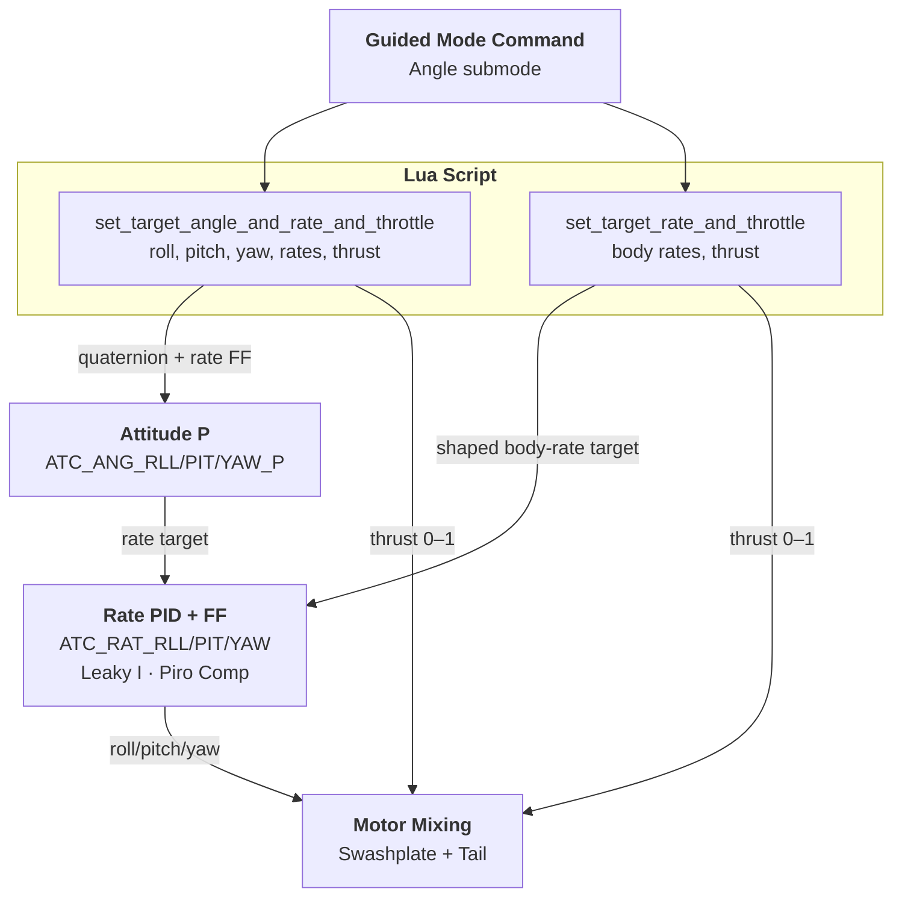
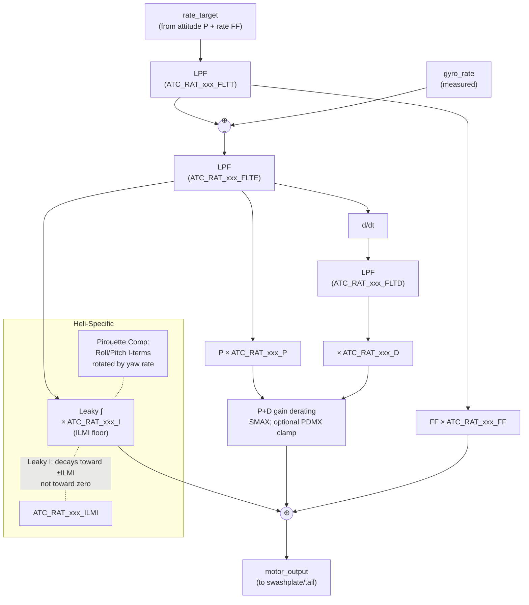

# Guided Mode Control Loops — Helicopter (RAWES Focus)

## Scope and Ownership

This is a low-level Guided/attitude-control deep dive.

- Canonical system-level behavior and mode ownership live in [flight_stack.md](flight_stack.md).
- This document should focus on ArduPilot control-chain internals and parameter effects.
- Avoid repeating full system architecture text already covered in [flight_stack.md](flight_stack.md).

The Python model of this chain is `arduloop/guided.py`,
`arduloop/attitude_heli.py`, and `arduloop/pid.py`. It models the control
math only — not firmware mode entry, spool state, landed state, timeouts, or
failsafes (those are in [arming.md](arming.md)). Where the Python model
differs from firmware, this document says so.

## 1. Overview

This document describes the control loop architecture for ArduPilot's **Guided mode** as used by the RAWES (Rotary Airborne Wind Energy System). It is intended for control system engineers who need to understand the signal flow from an attitude command down to swashplate and tail actuator outputs.

RAWES uses the **Angle submode** of Guided mode, which bypasses all position, velocity, and altitude controllers. ArduPilot exposes two relevant Angle-submode entry paths:

- **Angle + rate + thrust**: Lua provides an absolute attitude target, optional body-rate feed-forward, and direct thrust.
- **Rate-only + thrust**: Lua provides body-rate targets and direct thrust, but no absolute attitude target.

Current `scripts/rawes.lua` steady, passive, and takeoff behavior uses the **angle + rate + thrust** path (`set_target_angle_and_rate_and_throttle`). The **rate-only** path remains relevant because ArduPilot implements it, `arduloop` ports it, and tests still exercise it.

### High-Level Signal Flow



### Helicopter Rate Controller Detail (Per Axis)



---

## 2. Guided Mode Submodes

Guided mode supports multiple submodes. **RAWES uses exclusively the Angle submode.**

| Submode | Input | Active for RAWES? |
|---------|-------|----|
| TakeOff | Altitude target | No |
| Pos | 3D position (NEU) | No — routes through AC_PosControl |
| Accel | 3D acceleration | No — routes through AC_PosControl |
| VelAccel | Velocity + Acceleration | No — routes through AC_PosControl |
| PosVelAccel | Position + Velocity + Accel | No — routes through AC_PosControl |
| **Angle** | **Roll/Pitch/Yaw + Thrust** or **Body Rates + Thrust** | **Yes** |

### Angle Submode Entry

The Lua API enters the Angle submode by calling `ModeGuided::set_angle()`. No position, velocity, or altitude controller is involved. Inside `angle_control_run()`, ArduPilot chooses one of two attitude-controller inputs based on whether the stored quaternion is nonzero or zero.

#### Angle + Rate + Thrust Entry

**RAWES API**: `set_target_angle_and_rate_and_throttle(roll, pitch, yaw, roll_rate, pitch_rate, yaw_rate, throttle)`

This calls `set_angle(q, ang_vel_body, throttle, use_thrust=true)`:
- Euler angles are converted to a quaternion and passed to the attitude controller
- Body-rate feed-forward terms are added to the rate target (supply the known orbital angular velocity to reduce tracking lag)
- Throttle (0–1) goes directly to collective output, bypassing the vertical PID chain entirely

Control-chain summary:

```
roll/pitch/yaw + body-rate FF → set_angle(nonzero quaternion, rates, thrust, use_thrust=true)
                                → input_quaternion()
                                → attitude error + feed-forward blending
                                → heli rate PID
thrust                          → set_throttle_out(...)
                                → direct collective output
```

#### Rate-Only + Thrust Entry

**Alternative API (implemented in ArduPilot/arduloop, but not used by the current `scripts/rawes.lua` steady/passive/takeoff paths):** `set_target_rate_and_throttle(roll_rate, pitch_rate, yaw_rate, throttle)`

This calls the same `ModeGuided::set_angle(...)` storage path, but with a **zero quaternion**:

```cpp
Quaternion q;
q.zero();
mode_guided.set_angle(q, ang_vel_body, throttle, true);
```

At 400 Hz, `ModeGuided::angle_control_run()` detects that zero quaternion and switches from `input_quaternion(...)` to:

```cpp
attitude_control->input_rate_bf_roll_pitch_yaw(...);
attitude_control->set_throttle_out(thrust, apply_angle_boost=true, filt);
```

Important behavior:
- The caller does **not** provide an absolute attitude target.
- ArduPilot integrates the existing internal `_attitude_target`; this API does
  not reset that target from current body attitude. RAWES gives ACRO a
  ground-idle control interval after arm and before asserting CH8, then clears
  Copter's landed state in ACRO before entering GUIDED_NOGPS. See
  [arming.md](arming.md).
- Desired body rates are smoothed by `input_shaping_ang_vel(...)` using `ATC_INPUT_TC` and `ATC_ACCEL_R/P/Y_MAX`.
- The normal quaternion attitude controller still runs afterward, so this is **stabilized rate control**, not a raw PID-only passthrough.
- With requested rates `(0, 0, 0)`, the vehicle tries to settle body rates to zero while holding the internally conditioned attitude target.
- Throttle remains the same direct-thrust path as angle+rate+throttle; the Z PID chain is still bypassed.

When this path could help: if a controller knows "stop rotating" but not the correct absolute attitude for the current tether/wind state, rate-only Guided avoids commanding a wrong absolute attitude while still using ArduPilot's shaped rate and heli PID machinery. `rawes.lua` does not currently use it.

Control-chain summary:

```
body rates → set_angle(zero quaternion, rates, thrust, use_thrust=true)
           → input_rate_bf_roll_pitch_yaw()
           → input_shaping_ang_vel()
           → existing internal attitude target advanced by shaped rates
           → heli rate PID
thrust     → set_throttle_out(...)
           → direct collective output
```

### Vertical Path: Raw Thrust

```
thrust → attitude_control->set_throttle_out(thrust, apply_angle_boost=true)
       → helicopter collective path (angle boost only when enabled)
```

ArduPilot's position/velocity/acceleration Z-controller chain is bypassed.
The thrust value enters the helicopter collective path, subject to that path's
limits and any enabled angle boost. Lua steady/takeoff owns its own altitude
controller; passive holds the supplied thrust without running altitude feedback.

> **Note**: The equivalent MAVLink path is `SET_ATTITUDE_TARGET` with `GUID_OPTIONS` bit 3 set — both call the same `set_angle()` function with `use_thrust=true`.

#### Why Direct Collective for RAWES?

Lua runs its own guidance (tether geometry) and its
own altitude/thrust law instead of ArduPilot's position controllers. Those laws
are defined in [flight_stack.md](flight_stack.md#43-mode-1--steady-rawes_mode1).

---

## 3. Horizontal Control Chain (XY) — Bypassed by RAWES

**Not used by RAWES.** Lua sends attitude and thrust, not horizontal
position/velocity targets, so ArduPilot's horizontal position controller
(below) never runs. Lua's own guidance is documented in
[flight_stack.md](flight_stack.md#43-mode-1--steady-rawes_mode1).

For reference, the standard horizontal position controller chains:

```
Position error → P → Velocity target → PID → Accel target → accel_to_lean_angles() → Roll/Pitch
```

Its lean-angle limits therefore do not clamp Lua's attitude target.

---

## 4. Collective Path (Direct Thrust)

With either `set_target_angle_and_rate_and_throttle` or
`set_target_rate_and_throttle`, the thrust value (0–1) bypasses ArduPilot's Z
PID chain and goes directly to the helicopter collective path:

```
thrust (from Lua) → set_throttle_out(thrust, apply_angle_boost)
                  → collective = H_COL_MIN + thrust × (H_COL_MAX − H_COL_MIN)
```

The PSC altitude / velocity / acceleration controllers are therefore inactive on
this path; Lua owns the vertical controller.

`set_throttle_out(..., apply_angle_boost=true)` asks for angle boost. When
boost is enabled it is not a plain `thrust/cos(tilt)`; the Python port
(`_apply_throttle_out()`) scales around the collective midpoint and reduces
the boost when inverted:

```text
inverted_factor = clamp(2*cos(actual_tilt), -1, 1)
boost_factor = 1/max(0.1, abs(cos(thrust_angle)))
boosted = (thrust - collective_mid)*inverted_factor*boost_factor + collective_mid
```

The result is clamped to `[0,1]`. In the Python port boost is **off by
default** (`GuidedAttitudeParams.ATC_ANG_BOOST=False`) and is not read from
the parm files, so Python results say nothing about whether boost is active on
the vehicle; check the vehicle's parameters for that.

How Lua chooses attitude and thrust is defined in
[flight_stack.md](flight_stack.md#43-mode-1--steady-rawes_mode1).

---

## 5. Attitude Control Loop

### 5.1 Attitude Error → Body Rate Target (P Controller)

The attitude controller computes a quaternion error between the target and current attitude, then extracts an angular rate command proportional to the error:

```
attitude_error = thrust/heading decomposition of inverse(body_quat) * slewed_target_quat
ang_vel_target_roll  = att_error_roll  * ATC_ANG_RLL_P
ang_vel_target_pitch = att_error_pitch * ATC_ANG_PIT_P
ang_vel_target_yaw   = att_error_yaw   * ATC_ANG_YAW_P
```

- **Controller**: Quaternion thrust-vector/heading decomposition, with
  proportional/square-root attitude correction and acceleration/rate limits.
  The linear expressions above describe the small-error region.
- **Parameters**: `ATC_ANG_RLL_P`, `ATC_ANG_PIT_P`, `ATC_ANG_YAW_P` (units: rad/s per rad)
- **Output**: Body-frame angular rate targets in rad/s
- **Rate feedforward**: If the target attitude is changing (e.g., during a maneuver), the rate of change is added as feedforward
- **Code**: `AC_AttitudeControl::attitude_controller_run_quat()` → `update_ang_vel_target_from_att_error()`

In the angle path, `arduloop` first advances its internal target, then uses
`_attitude_command_model()` to shape target angular velocity **and angular
acceleration** with a third-order jerk-limited model. Roll/pitch use
`ATC_INPUT_TC`; yaw has `ATC_INPUT_TC_YAW` (the factories initialize it from
the same input time constant). The rate-only path separately uses
`_input_shaping_ang_vel()`.

The heading-error clamp depends on yaw rate P, yaw angle P, and yaw acceleration
limits, with a 45-degree ceiling. Thrust-error blending uses the angle between
**slewed target** and actual body thrust vectors: full feedforward through
30 degrees, fading roll/pitch feedforward and yaw authority from 30 to
60 degrees, and gyro yaw as the rate target above 60 degrees. This suppresses
yaw error demand; it does not guarantee zero yaw output in the presence of
stored I, feedforward, filtering, or trim.

---

## 6. Rate Control Loop (Helicopter-Specific)

This is where helicopter control diverges significantly from multicopter. The helicopter uses `AC_AttitudeControl_Heli` with `AC_HELI_PID` controllers.

### 6.1 Rate PID Structure

For each axis (roll, pitch, yaw):

```
rate_error = rate_target - gyro_rate

P_term   = rate_error * ATC_RAT_xxx_P
I_term   = integral(rate_error) * ATC_RAT_xxx_I    [with leaky integrator]
D_term   = d/dt(rate_error) * ATC_RAT_xxx_D
FF_term  = filtered_rate_target * ATC_RAT_xxx_FF
DFF_term = d/dt(filtered_rate_target) * ATC_RAT_xxx_D_FF

output = P_term' + I_term + D_term' + FF_term + DFF_term
         (P' and D' are P and D after SMAX/PDMX limiting, §6.4)
```

### 6.2 Leaky Integrator (ILMI)

Unique to helicopters, the integrator uses a **leak-to-minimum** strategy,
applied once per rate-loop tick with leak coefficient `0.02` (per tick, not
per second):

- If `|integrator| > ILMI`: the integrator leaks toward ±ILMI.
- If `|integrator| <= ILMI`: no leak. ILMI is a floor for leakage, not a
  forced minimum; with ILMI=0 the integrator leaks toward zero.

```
if |I_term| > ILMI:
    I_term -= (I_term - sign(I_term)*ILMI) * leak_rate
```

- **Parameter**: `ATC_RAT_xxx_ILMI` (axis-specific defaults live in the parm files)
- **Leak rate**: 0.02 (hardcoded constant `AC_ATTITUDE_HELI_RATE_INTEGRATOR_LEAK_RATE`)
- **Code**: `AC_HELI_PID::update_leaky_i()`

### 6.3 Pirouette Compensation

During yaw rotation, the roll and pitch I-terms are rotated to maintain their earth-frame orientation:

```
// When enabled, rotate the stored integrators after this tick's PID outputs
angle = -gyro_yaw_rate * dt
new_roll_I  = roll_I * cos(angle) - pitch_I * sin(angle)
new_pitch_I = roll_I * sin(angle) + pitch_I * cos(angle)
```

- **Code**: `AC_AttitudeControl_Heli::rate_bf_to_motor_roll_pitch()` (piro comp section)

### 6.4 Filtering

Each rate PID has configurable filters:

| Filter | Parameter | Description |
|--------|-----------|-------------|
| Target filter | `ATC_RAT_xxx_FLTT` | Low-pass on rate target input |
| Error filter | `ATC_RAT_xxx_FLTE` | Low-pass on rate error before P, I, and the D derivative |
| D-term filter | `ATC_RAT_xxx_FLTD` | Low-pass on derivative term |
| Slew suppression | `ATC_RAT_xxx_SMAX` | Derates P and D gains from their measured slew; not a hard post-sum slew clamp |
| PD magnitude limit | `ATC_RAT_xxx_PDMX` | Rescales P and D together when their sum exceeds the limit |
| Notch (target) | `ATC_RAT_xxx_NTF` | Selects the configured target notch; precedes FLTT |
| Notch (error) | `ATC_RAT_xxx_NEF` | Selects the configured error notch; precedes FLTE |

### 6.5 Flybar / Tail Passthrough Modes

For mechanical flybar helicopters or direct-drive tails:
- **Flybar passthrough** (`H_FLYBAR_MODE=1`): in ACRO only, pilot roll/pitch
  go straight to the swash. GUIDED still uses the full attitude/rate path.
- **Tail type**: `H_TAIL_TYPE=3` (DDFP) only selects the motor-driven tail; the
  yaw rate PID still runs.

---

## 7. Yaw Control in Guided Mode

### Yaw Control Chain

```
yaw_heading_target → attitude_error_yaw → ATC_ANG_YAW_P → yaw_rate_target
yaw_rate_target → rate_PID (ATC_RAT_YAW_*) → tail_output
```

For RAWES, the yaw axis is controlled by an anti-rotation motor whose sole purpose is to counter the reaction torque from the spinning rotor. The yaw PID should ideally see only yaw rate error — no coupling from collective or cyclic.

### Collective → Yaw Coupling Paths (Unwanted for RAWES)

ArduPilot's helicopter mixer can add collective-dependent yaw compensation,
designed for engine-driven rotors. RAWES turns the static term off
(`H_COL2YAW=0`) and instead lets the Lua trim observer learn the yaw trim from
measured motor output and yaw rate.

#### 1. `H_COL2YAW` — Collective-to-Yaw Feedforward

**Firmware source**: `AP_MotorsHeli_Single.cpp`, `get_yaw_offset()`

Adds a yaw offset proportional to collective pitch raised to the 1.5 power:

```
yaw_offset = H_COL2YAW × |collective − zero_thrust_pct|^1.5
```

RAWES sets `H_COL2YAW = 0`, so collective changes from the altitude loop add
no yaw command through this path.

#### 2. `H_YAW_TRIM` — Fixed Yaw Bias (DDFP Tails)

**Firmware source**: `AP_MotorsHeli_Single.cpp`, DDFP yaw trim path

Adds a constant offset to the yaw output for DDFP (Direct Drive Fixed Pitch) tail types. This is a static trim to reduce I-term load in hover.

Current RAWES operation writes `H_YAW_TRIM` from `rawes.lua`'s trim observer, so
the important question is whether the live observer output matches the expected
steady-state anti-rotation operating point.

#### 3. Angle Boost → Collective → COL2YAW Chain

**Firmware source**: `AC_AttitudeControl_Heli.cpp`,
`set_throttle_out()` / `get_throttle_boosted()`

Angle boost (Section 4) changes collective, which would feed `H_COL2YAW` if it
were nonzero. With `H_COL2YAW=0` this path adds no yaw command.

#### 4. Collective Margin Lean Limit

**Firmware source**: `AC_AttitudeControl_Heli.cpp`,
`update_althold_lean_angle_max()`

This lean limit applies to callers that use it (e.g. altitude-hold lean
conversion), not to the direct GUIDED quaternion target RAWES sends.

### Summary of Yaw Coupling Parameters

This section names the relevant coupling points, but it does **not** own the
live numeric defaults. Use:

- [`tests/sitl/rawes_common_defaults.parm`](../tests/sitl/rawes_common_defaults.parm)
  for current project overrides such as `H_COL2YAW=0`, `ATC_RAT_YAW_*`, and the
  yaw-motor wiring;
- [`tests/sitl/copter-heli.parm`](../tests/sitl/copter-heli.parm)
  for heli baseline defaults;
- `rawes.lua` for runtime updates such as the `H_YAW_TRIM` observer.

---

## 8. Input Shaping

Position/velocity S-curve shaping is bypassed in the Angle submode. The Python
angle-path model uses the jerk-limited `attitude_command_model` (Section 5);
rate-only commands use the rate shaper. Both are separate from Lua's own
elevation slew, tension ramp, and post-capture blending.

---

## 9. Feed-Forward Paths Summary

| Loop Layer | Feed-Forward Source | Parameter | Purpose |
|------------|-------------------|-----------|---------|
| Roll Rate PID | Rate target | `ATC_RAT_RLL_FF` | Rate-target feedforward |
| Pitch Rate PID | Rate target | `ATC_RAT_PIT_FF` | Rate-target feedforward |
| Yaw Rate PID | Rate target | `ATC_RAT_YAW_FF` | Rate-target feedforward |
| Attitude Loop | Target attitude rate of change | (internal) | Smooth attitude tracking |
| Attitude Loop | Lua rate arguments | (from API) | Unused: `rawes.lua` sends zero rates |

Which term dominates depends on the gains and the plant; check `PID_TUNING`
telemetry for a given run.

---

## 10. Parameter ownership

This document explains **where** the key ArduPilot parameters act in the
control chain; it deliberately does **not** duplicate the live numeric tables.
Those are owned by:

- [`tests/sitl/copter-heli.parm`](../tests/sitl/copter-heli.parm) for ArduPilot heli defaults and inline explanations;
- [`tests/sitl/rawes_common_defaults.parm`](../tests/sitl/rawes_common_defaults.parm) for RAWES-specific overrides;
- `arduloop/params.py` for the Python-port field names and fallback handling (`ATC_ACC_*_MAX` vs `ATC_ACCEL_*_MAX`, `H_SW_H3_PHANG`, etc.).

---

## 11. Loop Execution Order (Per Control Cycle)

Current RAWES usage is asymmetric:

1. **Lua script** (steady/takeoff send every 50 Hz flight tick; passive and
   the GUIDED-entry hold send only on change, ≤20 Hz, plus a 1 Hz keepalive):
   - Steady, passive, and takeoff all call
     `set_target_angle_and_rate_and_throttle(...)` with an absolute attitude
     and a direct thrust value.
   - The rate-only API (`set_target_rate_and_throttle(...)`) is not used by
     `rawes.lua`; it is modeled in `arduloop` for tests.

2. **Angle + rate + thrust path** (~400 Hz):
   - input shaping slews `_attitude_target` toward the commanded quaternion;
   - quaternion attitude error produces body-rate targets;
   - body-rate feed-forward is blended by thrust-vector error angle.

3. **Rate controller** (~400 Hz):
   - `ATC_RAT_*` filtering/PID/FF compute roll, pitch, and yaw outputs;
   - helicopter-specific logic applies leaky I, piro compensation, hover-roll
     trim, and swash phase rotation.

4. **Direct thrust** (same cycle):
   - the Lua thrust value goes through `set_throttle_out()` into the helicopter
     collective mapping.

5. **Motor mixing**:
   - roll/pitch/collective feed the swashplate path;
   - yaw feeds the anti-rotation motor path.

---

## 12. Source Code References

The Python model is in `arduloop/guided.py`, `arduloop/attitude_heli.py`,
`arduloop/pid.py`, and `arduloop/params.py`. To compare with firmware, use the
ArduPilot release pinned in `simulation/Dockerfile`.

Two Python behaviors are simplifications, not firmware models:

- **Timeout:** after `timeout_s` with no new target, the controller resets its
  target and rate state to the current attitude and drops direct thrust. Do not
  read this as firmware `GUID_TIMEOUT` behavior.
- **Climb-rate path:** a simplified vertical controller, not a full port of
  `AC_PosControl`.

See [arduloop/README.md](../arduloop/README.md).

---

## 13. Diagram Legend

| Symbol | Meaning |
|--------|---------|
| **P** | Proportional controller |
| **PID** | Full PID controller |
| **FF** | Feed-forward path |
| **LPF** | Low-pass filter |
| **⊕** | Summation point |
| **Leaky ∫** | Helicopter leaky integrator (ILMI) |

---

## 14. Application to RAWES (Rotary Airborne Wind Energy System)

For current RAWES ownership and behavior, use [flight_stack.md](flight_stack.md).
This document's verified scope ends at the generic ArduPilot guided / heli
control chain above.
