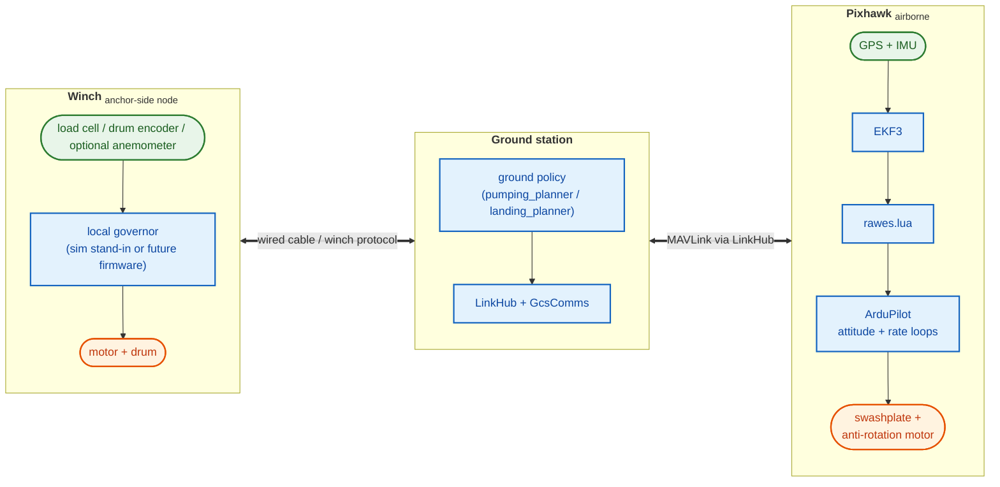

# RAWES — Flight Control Stack Reference

Primary reference for system ownership, ground/vehicle command contracts, and
Pixhawk Lua behavior. Transport and journal architecture belong to
[linkhub.md](linkhub.md); physical-world simulation to
[simulation.md](simulation.md); startup and safe-off procedures to
[arming.md](arming.md); AP control internals to
[GUIDED_CONTROL_LOOPS.md](GUIDED_CONTROL_LOOPS.md); EKF bring-up to
[EKF_GATING.md](EKF_GATING.md). The complete ownership index is in the
[root README](../README.md#documentation-map).

---

## 1. System Architecture

### Software ownership across hardware and SITL

LinkHub is the sole MAVLink owner between ground-side clients and ArduPilot.
Production planners in `groundstation/`, calibration, and the browser use its
HTTP/JSON API; they do not independently open vehicle transports or maintain
duplicate MAVLink journals. LinkHub owns rate requests and transport throughput
measurement (`rx_bps` / `tx_bps`), not flight policy.

ArduPilot owns estimation, modes, Lua guidance, attitude/rate control, and servo
mixing. The simulation mediator replaces only the physical world and lockstep
adapter: aero, dynamics, tether, wind, sensors, hardware plants, and actuator
application. Production ground policy runs outside it, including when tests host
that policy in-process through production command boundaries.

The SITL harness owns process orchestration, deadlines, and artifacts. It joins
raw mediator physics telemetry with LinkHub observations after the run; the
mediator must not consume MAVLink just to enrich CSV rows. The diagram below
describes physical nodes, not permission for the ground planner to bypass LinkHub.

Three physical nodes — **winch**, **ground station**, **Pixhawk**. The winch is a
standalone anchor-side unit (drum + motor + load cell + optional anemometer)
that exposes only the cable-side `WinchCommand` / `WinchTelemetry` boundary. The
ground station runs production policy from `groundstation/` and reaches the
Pixhawk only through LinkHub. `rawes.lua` on the Pixhawk owns all flight control;
the ground station forwards only slow setpoints such as **commanded tension** and
**target altitude** — never the measured/load-cell tension.



**What flows on each link:**

- **Winch cable boundary (winch ↔ ground):** `WinchTelemetry` up (`tension_n`, `rest_length`, `speed_ms`, `net_energy_j`, `wind_ned`) and `WinchCommand` down (`cruise_v`, `tension_target`). No hub attitude/position crosses this boundary.
- **MAVLink radio (ground ↔ Pixhawk):** slow setpoints up (phase/substate, target altitude, **commanded** tension, mode/command messages) and telemetry/journal data down through LinkHub.

**Key design principles:**

- **`rawes.lua` owns flight guidance, ArduPilot owns actuator mixing.** Lua sends GUIDED attitude/throttle setpoints; it does not own servo mixing.
- **Orientation comes from tether geometry plus commanded tension.**
  `bz_altitude_hold` points the disk using the actual tether elevation
  (slew-limited), a low-passed position azimuth, and the ramped **commanded**
  tension, with a gravity correction along the elevation direction (§4.3).
  The vehicle never uses measured tension.
- **Altitude hold owns collective.** A 50 Hz PID on altitude error (target altitude vs. actual) sets thrust/collective, with warm-start from the IC thrust. This is the fast disturbance rejector in steady flight.
- **Tension feedback stays on the winch.** The vehicle never sees the load cell. Commanded tension reaches the AP via `RAWES_TEN` as an input to its base orientation geometry.
- **Production ground policy lives in `groundstation/`; simulation-only hardware stand-ins stay in `simulation/`.** `simulation.winch`, `simulation.winch_node`, and related helpers model hardware that does not yet exist as a separate deployed node.

For detail on individual blocks see §3 (ground), §4 (rawes.lua modes / pre-GPS behaviour / channel ownership), and [GUIDED_CONTROL_LOOPS.md](GUIDED_CONTROL_LOOPS.md) (ArduPilot internals).

---

## 2. Concepts & Glossary

### 2.1 Glossary

| Term | Meaning |
|---|---|
| body_z | Unit vector along the rotor axle (spin axis), NED frame |
| bz_altitude_hold | Lua function: tether elevation/azimuth + **commanded** tension + gravity → target disk axis (`bz_goal`). Python equivalent: `compute_bz_altitude_hold`. Uses no measured tension. |
| Elevation hold | Slew-limiting the elevation used by `bz_altitude_hold` toward the actual tether elevation (`RAWES_SLW`). |
| TensionCommand | Ground-side 10 Hz Python record (commanded tension, target altitude, phase). Sent to the AP as the named floats `RAWES_TEN`, `RAWES_ALT`, `RAWES_SUB` (§3.3). |
| NED | North-East-Down coordinate frame. Altitude = −pos[2]. Up = [0,0,−1]. |
| Slerp | Spherical linear interpolation used by the Python `slerp_body_z()` helper. Lua's capture blend uses normalized linear interpolation. |
| Rodrigues | Unit-vector rotation formula used by the Python body-z interpolation helpers. |
| xi | Angle between body_z and the horizontal wind direction [deg]. xi=0 → tether-aligned. xi=80° → disk nearly perpendicular to wind (reel-in tilt). |
| RAWES_SUB | Generic substate index sent by ground to rawes.lua. Current production pumping uses hold=0, reel-out=1, reel-in=3; other values remain reserved by the shared constants in `groundstation.rawes_modes`. |
| RAWES_ALT | Named float: target altitude [m]. The AP's altitude PID drives thrust toward it (reference frame per mode: §4 named-float table). |
| RAWES_TEN | Named float: **commanded** tether tension [N], the same target the winch uses. Input to the orientation geometry — never a measurement. |
| RAWES_ARM | Named float: timed disarm countdown [ms] for an already-armed vehicle. Re-send refreshes the timer; it never arms. |

### 2.2 Physical and Control Variables

| Symbol | Name | Description |
|---|---|---|
| pos | Hub position | 3D position of rotor hub in NED [m] |
| vel | Hub velocity | 3D velocity of rotor hub in NED [m/s] |
| body_z | Disk axis | Unit vector along rotor axle (≈ tether direction at equilibrium) |
| xi | Disk tilt from wind | Angle between body_z and horizontal wind direction [deg] |
| el | Tether elevation | `asin(alt / tlen)` — elevation angle of tether above horizontal [rad] |
| T | Tether tension | Force along tether at anchor [N] |
| L0 | Tether rest length | Unstretched tether length [m], changed by winch |
| theta_col | Collective pitch | Average blade pitch [rad]; driven by GUIDED throttle path |
| v_winch | Winch speed | Tether length change rate [m/s]. +ve = pay out, −ve = reel in |

---

## 3. Ground Station

### 3.1 Overview

Production ground policy lives in `groundstation/`:

- `groundstation.pumping_planner.PumpingGroundController` — current pumping schedule owner;
- `groundstation.landing_planner.LandingGroundController` — landing-side controller code currently used by tests, not by deployed Lua flight control;
- `groundstation.unified_ground.GcsComms` — production `TensionCommand` → `NamedValueFloat` adapter through LinkHub;
- `groundstation.winch_protocol` — the real ground↔winch wire contract (`WinchCommand`, `WinchTelemetry`).

Ground sends setpoints only. The airborne contract is a `TensionCommand`
containing **commanded** tension, target altitude, and a phase label. Ground does
not send measured tension or direct collective commands to the AP.

### 3.2 Current Pumping Planner

The current `PumpingGroundController` is a **length-driven two-phase cycle plus
hold**. Its public `phase` strings are currently only:

| Phase | Current planner behavior |
|---|---|
| `hold` | Wait for `notify_captured()` plus `capture_settle_s`; command `tension_ic`, hold the current rest length, zero cruise velocity. |
| `reel-out` | Target `start_length + delta_l`; ramp commanded tension toward `tension_out`; command positive cruise velocity. |
| `reel-in` | Target `start_length`; ramp commanded tension toward `tension_in`; command negative cruise velocity. |

Current production pumping keeps `RAWES_ALT` fixed at the capture altitude
(`target_alt_m`) and ramps `RAWES_TEN` on the ground over `tension_ramp_s`
before Lua applies its own `RAWES_TRP` smoothing. The reserved transition
substates in `groundstation.rawes_modes` are not emitted (§4.4).

**Winch control (simulation-only hardware stand-ins):**

The fast load-cell loop runs inside the winch node, not on the vehicle. The
simulated node (`GovernedWinchNode`) uses `GovernedWinchController`: cruise
velocity plus a proportional tension correction, then speed, acceleration, and
jerk limits. Control laws are in
[simulation.md](simulation.md#winch-and-ground-side-boundaries).

### 3.3 TensionCommand Protocol

Ground→AP setpoint record (10 Hz), carried by `simulation.unified_ground`
(simtests) or `groundstation.unified_ground.GcsComms` (stack / hardware):

```python
@dataclass(frozen=True)
class TensionCommand:
    tension_target_n: float     # commanded/feed-forward tension; AP feeds it into the orientation force balance
    alt_m: float                # target altitude; AP's altitude PID drives collective toward it
    phase: str                  # current production planner: "hold" | "reel-out" | "reel-in"
```

`TensionCommand` is a Python data record, not a MAVLink `COMMAND_LONG`.
`GcsComms.send()` marshals it into three `NAMED_VALUE_FLOAT` messages:
`RAWES_TEN`, `RAWES_ALT`, and `RAWES_SUB`.

`groundstation.unified_ground._PHASE_TO_SUB` contains a reserved
`"transition" -> 2` mapping, but the current pumping planner
never emits that phase string.

### 3.4 Winch Node Protocol Boundary

`WinchCommand` / `WinchTelemetry` enforce the production cable boundary; the
simulation-side `GovernedWinchNode` hosts a stand-in fast loop behind that
boundary:

- Planner calls `exchange(WinchCommand)` and receives `WinchTelemetry`.
- The node's local fast loop consumes only local sensors (`tension_n`, drum
  state, co-located anemometer).
- The mediator feeds stand-in physics through `update_sensors(...)` and `step(dt)`.
- No hub altitude / position / attitude crosses this cable boundary.

### 3.5 Wind Estimation

There is **no production `WindEstimator` class in `groundstation/` today**. The
current cable contract exposes wind only as `WinchTelemetry.wind_ned`, i.e. the
co-located anemometer reading from the winch side. In simulation that reading is
produced by `simulation.winch_node.Anemometer`. Any future ground-side wind
estimator must sit above this boundary; it is not part of the current deployed
contract.

---

## 4. Pixhawk Lua Scripts

### Command, setpoint, and telemetry roles

`scripts/rawes.lua` is authoritative for which commands and named values are
active: an input is supported only if the script handles or consumes it. The
current script uses **both commands and named values**, for distinct purposes:

| Purpose | Current wire mechanism | Contract |
|---|---|---|
| Enter GUIDED holding current attitude; capture/activate passive hold | `COMMAND_LONG`: `ENTER_GUIDED` / `ENTER_PASSIVE` | Lua handles the action and returns `COMMAND_ACK`; details below. |
| Arm/disarm and other native vehicle actions | ArduPilot MAVLink commands | ArduPilot handles the action and acknowledgement. |
| Select `RAWES_MODE` or configure gains | Parameter transactions through LinkHub | Selects configuration; does not replace the required entry commands. |
| Update tension, altitude, phase, thrust, passive offsets, or manual/setup inputs | `NAMED_VALUE_FLOAT` | Live inputs consumed by Lua; no per-value `COMMAND_ACK`. |
| Supply anchor latitude/longitude/altitude | `NAMED_VALUE_INT` | Integer-coordinate inputs resolved onboard. |
| Publish Lua control diagnostics | `DEBUG_FLOAT_ARRAY` | One keyed diagnostic array; not named-float command traffic. |

Example — passive entry: with the vehicle armed in `RAWES_MODE=2` and
`RAWES_THR` sent, the client sends `ENTER_GUIDED`; once the hold is quiet it
sets `RAWES_MODE=3` and sends `ENTER_PASSIVE`. Later thrust and offset changes
are named floats. The full sequence and its safety gates are in
[arming.md](arming.md#passive-bench-startup). Pumping uses only named floats
(`RAWES_TEN`, `RAWES_ALT`, `RAWES_SUB`, via `GcsComms`).

### 4.1 rawes.lua Overview

Single unified controller (`scripts/rawes.lua`) on a 100 Hz base tick
(`BASE_PERIOD_MS=10`). Steady and takeoff guidance are gated to 50 Hz
(`FLIGHT_PERIOD_MS=20`); manual/setup control, interlock, tension smoothing,
and active yaw-trim updates run on the base tick. Static GUIDED holds send
changed targets at no more than 20 Hz and unchanged keepalives at 1 Hz.

#### Mode-dependent control paths

The loop is mode-dependent but the command boundary is consistent: `rawes.lua`
converts ground inputs plus onboard state into **GUIDED attitude/throttle
setpoints** (or ACRO RC overrides in modes 2 and 6), while ArduPilot owns the
400 Hz attitude/rate loops and servo mixing.

| Mode | Attitude / body_z behavior | Collective / thrust behavior | Used for |
|---|---|---|---|
| 0 — none | no GUIDED guidance; neutral RC1/RC2 while disarmed | neutral RC3 while disarmed; CH4 yaw neutral and CH8 interlock still managed | logging / canonical disarmed idle |
| 1 — steady | `bz_goal` from tether geometry + commanded tension; sent through `set_target_angle_and_rate_and_throttle(...)` with zero rate inputs | 50 Hz altitude PID on actual altitude; output goes through GUIDED throttle | steady flight and pumping |
| 2 — ACRO manual | normalized `RAWES_RLL` / `RAWES_PIT` through ACRO flybar passthrough | normalized `RAWES_COL` through ACRO collective | manual bench / flight staging |
| 3 — passive | Lua-captured AHRS quaternion anchor composed with relative `RAWES_ROFF` / `RAWES_POFF` / `RAWES_YOFF` offsets (§4.2b) | IC thrust via GUIDED throttle | armed-but-quiet kinematic release hold |
| 4 — landing | reserved in the current script; no landing controller runs here yet | reserved | reserved |
| 5 — takeoff | fixed level attitude (`roll=pitch=0`, current yaw) via GUIDED angle target | altitude-PID climb toward `RAWES_ALT` | vertical climb before handoff to steady |
| 6 — collective | disarmed ACRO only; fresh bounded cyclic inputs, neutral yaw and low interlock | fresh `RAWES_COL` through ACRO collective; no GUIDED targets or yaw-trim observer | collective/cyclic bench calibration; [safety contract](arming.md#disarmed-collective-setup) |

**Before the first valid position fix:**

- steady mode holds the current attitude and warm-start thrust until anchor and
  position data are usable;
- takeoff mode holds a level attitude and IC thrust until position is available;
- passive mode waits for explicit activation through `ENTER_PASSIVE`.

**RAWES_\* script-generated parameters.** `rawes.lua` registers the current
script-generated parameters directly in code: `RAWES_MODE`, `RAWES_YAW_SLP`,
`RAWES_KP_ALT`, `RAWES_KI_ALT`, `RAWES_KD_VZ`, `RAWES_SLW`, `RAWES_TEL_HZ`, `RAWES_YFF_MAX`,
`RAWES_YFF_TAU`, and `RAWES_TRP`. The **current defaults** are owned by
[`tests/sitl/rawes_common_defaults.parm`](../tests/sitl/rawes_common_defaults.parm);
this document owns only the behavioral contract.

**Diagnostic telemetry (Lua → ground, `DEBUG_FLOAT_ARRAY`).** `rawes.lua`
sends all of its diagnostic floats as one MAVLink `DEBUG_FLOAT_ARRAY`
(msgid 350, `array_id` 1, `name` `RAWES_DIAG`) at `RAWES_TEL_HZ` (read on every
tick, so a write applies live; `0` disables; the LinkHub UI telemetry profile
sets it, see [UI README](../linkhub-ui/README.md#telemetry-behavior)). It uses
`mavlink.send_chan` on every channel slot, because `send_chan` targets one
channel and ArduPilot's Lua bindings can only send message IDs compiled into
the firmware (a custom message would need a custom firmware build).

- `data[0]` is a bitmask (float-encoded integer) of the keys set this tick; bit
  *i* set means `data[1 + i]` holds `DIAG_KEYS[i]`. Unset keys are sent as 0.0,
  so a clear bit, not a zero, means "absent". NaN is not used because
  LinkHub's JSON turns it into `null`.
- The ordered key list is owned by
  [`groundstation/rawes_diag.py`](../groundstation/rawes_diag.py)
  (`DIAG_KEYS`, `diag_values()`); `rawes.lua`'s `_diag_nvf_keys` and
  `linkhub-ui/src/diag-array.ts` mirror it, and
  `tests/unit/test_rawes_diag.py` checks all three. Append new keys at the
  end and keep all decoders aligned with the wire schema.
- Keys: yaw trim observer (`YFF_T/U/GZ`), commanded body rates (`OL_RSP/PSP/YSP`),
  rate errors (`OL_RER/PER/YER`), altitude PID terms and thrust
  (`OL_AP/AI/AD/COL`), ramped tension feedforward (`OL_TEN`) and the resolved
  anchor offset (`ANCH_N/E/D`).
- `OL_EL` and `BZG_N/E/D` are still stored by the script (the in-process simtest
  mock reads them) but are not sent: nothing consumes them over MAVLink, and
  SITL takes `elevation_rad`/`bz_eq` from the mediator.
- LinkHub collapses `DEBUG_FLOAT_ARRAY` per `array_id` for `collapse=true`
  reads. The array has `time_usec` rather than `time_boot_ms`, so its journal
  records carry the last observed simulation time (`LastObserved`).
- Readers: `analysis/enrich_sitl_telemetry.py` (SITL telemetry columns),
  `calibrate/run.py`, the SITL torque/steady tests, and the LinkHub UI
  (`YFF_U`). This array is output only; ground-to-Lua inputs are the
  commands and named values described below.

**Named float inputs (ground → Lua, via `gcs.send_message(NamedValueFloat(...))`):**

| Name | Value | Purpose |
|---|---|---|
| RAWES_ARM | positive ms | Start/refresh a disarm countdown only if already armed. Ignored with a warning while disarmed; does not arm. |
| RAWES_SUB | integer substate | Generic substate/diagnostic index. Current pumping uses `0=hold`, `1=reel-out`, `3=reel-in`; `2/4` remain reserved and `1` is also the landing final-drop value in `groundstation.rawes_modes`. |
| RAWES_ALT | m | Altitude target: steady measures above the resolved anchor; takeoff measures above the EKF origin (§4.5). |
| RAWES_TEN | N | **Commanded** tether tension (the winch setpoint, broadcast to the AP). Feedforward into the orientation force balance in steady flight. Never the measured/load-cell tension. Ramped locally by RAWES_TRP. |
| RAWES_ROFF | rad | Passive roll offset relative to the Lua-captured anchor (§4.2b). Latched; may be sent before or after ENTER_PASSIVE. |
| RAWES_POFF | rad | Passive pitch offset relative to the Lua-captured anchor. |
| RAWES_YOFF | rad | Passive yaw offset relative to the Lua-captured anchor. |
| RAWES_THR | [0..1] | IC/passive thrust seed. ENTER_GUIDED requires it; passive and takeoff warm-start from it. |
| RAWES_RLL | [-1..1] | ACRO roll input with inverse RC MIN/TRIM/MAX mapping. Latched in mode 2; mode 6 uses fresh inputs bounded to the unit cyclic circle under the [setup safety contract](arming.md#disarmed-collective-setup). |
| RAWES_PIT | [-1..1] | ACRO pitch input; positive is ArduPilot positive pitch. Latched in mode 2; mode 6 uses the same freshness/circle bounds as roll. |
| RAWES_COL | [0..1] | ACRO collective input using RC3 MIN/MAX and reversal. Latched in mode 2; mode 6 requires fresh updates under the [disarmed setup safety contract](arming.md#disarmed-collective-setup). |

**Command inputs (ground → Lua, via `COMMAND_LONG`):** entry/capture actions use
script-handled MAVLink commands. Named values carry the setpoints listed above.
rawes.lua calls
`mavlink:block_command(id)` so ArduPilot's GCS command handler skips them
(no autopilot ACK), receives the COMMAND_LONG through its rx queue, and sends
the single `COMMAND_ACK` itself on the receiving channel. Ground clients
retry with an incremented `confirmation`; Lua treats a retry of an already
completed command as ACCEPTED without repeating the side effect. Rejections
also emit `RAWES cmd <id> rejected: <reason>` STATUSTEXT. IDs live in
`groundstation/rawes_modes.py` (`CMD_*`, typed `MavCmd.USER_1`/`USER_2`;
`send_rawes_command` requires `MavResult.ACCEPTED`) and `linkhub-ui/src/passive.ts`.

| Command | ID | Params | Lua action | Gate (else DENIED; set_mode failure → FAILED) |
|---|---|---|---|---|
| ENTER_GUIDED | 31010 (`MAV_CMD_USER_1`) | none | Captures the current AHRS quaternion, calls `vehicle:set_mode(GUIDED_NOGPS)` and installs that attitude + IC thrust in the same tick, then holds it (guided-entry hold; re-sent only on change or as a 1 s keepalive, see §4.2b) until ENTER_PASSIVE, disarm, or leaving the guided/acro staging flow. This removes the level-target transient that `ModeGuided::angle_control_start()` would otherwise command before the first ground target arrives. | armed, `RAWES_MODE=2`, IC thrust seeded, AHRS healthy |
| ENTER_PASSIVE | 31011 (`MAV_CMD_USER_2`) | param1 = yaw-trim seed [0, `RAWES_YFF_MAX`]; negative = adaptive observer (clears any earlier seed) | Captures the passive quaternion anchor (§4.2b), enables passive hold, and ends the guided-entry hold. | `RAWES_MODE=3`, AHRS healthy |

**Named int inputs (ground → Lua, via `gcs.send_message(NamedValueInt(...))`, one-shot anchor location):**

| Name | Value | Purpose |
|---|---|---|
| RAWES_LAT | deg × 1e7 | Anchor latitude. |
| RAWES_LON | deg × 1e7 | Anchor longitude. |
| RAWES_AAL | cm, AMSL | Anchor altitude. |

Sent as NAMED_VALUE_INT (not FLOAT) to preserve ArduPilot's own Location int32
precision (~1 cm) end-to-end — a float32 NVF would quantize latitude to
~0.5–1 m. Lua converts this absolute location into the EKF-local NED anchor
offset on board via `Location:get_vector_from_origin_NEU_m()`, which returns
`nil` until the EKF origin is set, so all three ints must arrive AND the
onboard conversion must succeed at least once before MODE_STEADY initialises
altitude hold (see `_try_resolve_anchor()` in rawes.lua).

**MAVLink rx queue:** `mavlink:init(queue_size, num_msgs)` is called as
`(20, 10)` at module load. The first arg is the receive queue depth;
`update()` drains all queued input kinds before applying mode-specific control.
NAMED_VALUE_FLOAT (msgid 251), NAMED_VALUE_INT (msgid 252) and
COMMAND_LONG (msgid 76) are registered and share this one queue; the drain loop peeks the 3-byte msgid
at byte offset 10 (`string.unpack("<I3", raw, 10)`) to dispatch each message.

Named inputs generally remain latched across mode changes. Mode-6 entry and
exit explicitly discard its collective/cyclic seeds; leaving active manual
control releases its RC overrides. Do not rely on a blanket `_nv_floats`
reset: `_on_mode_enter()` does not perform one. Anchor ints and the resolved
anchor offset persist once resolved.

**Key physical constants:**

| Constant | Value | Meaning |
|---|---|---|
| MASS_KG | 5.0 | Hub + rotor mass |
| G_ACCEL | 9.81 | Gravity [m/s²] |
| MIN_TETHER_M | 0.5 | Minimum tether length before GPS init activates elevation hold |
| THRUST_SLEW_MAX | 0.058 | Max thrust change per 50 Hz step |

The runtime mapping is thrust `[0..1]` to collective `[rad]` using rotor YAML
`control.col_min_rad/control.col_max_rad` combined with ArduPilot `H_COL_*`
via `load_collective_phys_range()`.

### 4.2 Steady capture before usable position and anchor

Before `_el_initialized` is set, steady mode:

1. Holds `ic_thrust_or_default()`: `RAWES_THR` if seeded, otherwise
   `_last_thrust` (initially zero). Ground must supply the intended warm-start.
2. With healthy AHRS, commands current roll/pitch/yaw and zero rate inputs.
   This is an attitude command, not a guarantee of zero controller output.

Capture requires usable EKF position, a successfully resolved anchor, and
anchor-relative distance at least `MIN_TETHER_M`. It seeds elevation, azimuth,
tension smoothing, thrust trim, and integrator state. Target altitude uses a
received `RAWES_ALT`, or current anchor-relative altitude if none was supplied.
Only steady mode uses this capture step; passive, manual, and takeoff do not.

### 4.2b Mode 3 — Passive (RAWES_MODE=3)

Armed-but-quiet mode used during the kinematic hold/release of stack tests.
The vehicle stays armed (motor interlock ch8 high) and does **not** write
swashplate channels directly or run body_z/altitude/winch guidance.

**Ground-owned capture gate.** After the temporary landed-state-clearing
collective, ground sends the ENTER_GUIDED command. Lua switches to
GUIDED_NOGPS and holds the attitude it captured in that same tick (see the
command table above), so there is no window in which ArduPilot's level entry
target is active.

**Lua-owned quaternion anchor.** Ground sets `RAWES_MODE=3` (the guided-entry
hold keeps streaming) and then sends ENTER_PASSIVE. Lua performs a final AHRS
health/quaternion-validity check, captures `ahrs:get_quaternion()` once,
enables passive hold, and acknowledges the command. Ground sends complete
relative state through:

- `RAWES_ROFF` — roll offset [rad];
- `RAWES_POFF` — pitch offset [rad];
- `RAWES_YOFF` — yaw offset [rad].

Lua computes `q_target = q_anchor * q_relative`, normalizes it, and converts to
Euler only at the final `set_target_angle_and_rate_and_throttle` API boundary.
The target is sent when it changes (at most every `PASSIVE_TARGET_PERIOD_MS`,
50 ms) and otherwise only as a `GUIDED_KEEPALIVE_MS` (1 s) keepalive, well
inside `GUID_TIMEOUT` (3 s): every `vehicle:*` binding takes the scheduler
semaphore and repeated calls starve the scripting thread in SITL. No
`AP_Vehicle` call is made before activation and passive hold does not
separately poll `vehicle:get_mode()`. The anchor remains fixed until hold is
explicitly disabled.

Lua owns continuous RC fallback throughout the handoff. ACRO staging temporarily
uses the passive collective to clear landed state. Mode 3 changes RC1-RC4 to
neutral roll, pitch, collective, and yaw before its first steady
`vehicle:set_target_*()` call, and keeps those overrides active in GUIDED_NOGPS.

**Yaw observer.** Passive yaw trim remains inhibited before ENTER_PASSIVE.
After the fixed anchor is active, `run_yaw_trim()` may operate alongside the
angle hold and reads actual SERVO9 output via
`SRV_Channels:get_output_pwm(36)` (see §5.2).

### 4.3 Mode 1 — Steady (RAWES_MODE=1)

Post-GPS, each 50 Hz step:

1. Rate-limit `_el_rad` toward **actual** tether elevation at `RAWES_SLW`.
   Low-pass position azimuth into `_az_ref` with `AZ_REF_TAU_S`. Neither
   reference tracks the altitude setpoint or a measured wind direction.
2. **Base orientation:** `bz_goal = bz_altitude_hold(rel, _el_rad, _tension_n, _az_ref)`.
   With elevation `el` and azimuth `az`, the exact geometry is:

   ```text
   t_hat = [-cos(el) cos(az), -cos(el) sin(az), sin(el)]
   e_dn  = [ sin(el) cos(az),  sin(el) sin(az), cos(el)]
   bz_goal = normalize(t_hat + mass*g*cos(el)/max(T_ramped, 1) * e_dn)
   ```

   The tension state follows `T += dt/RAWES_TRP * (RAWES_TEN - T)` on the
   100 Hz base tick (or steps immediately if `RAWES_TRP<=0`); capture seeds it
   directly from the command. No load-cell reading enters this law.
3. **Attitude:** convert `bz_goal` to roll/pitch via `bz_ned_to_roll_pitch` and command the
   GUIDED angle path (`vehicle:set_target_angle_and_rate_and_throttle`), so ArduPilot's
   native attitude + rate PID closes the cyclic loop at 400 Hz.
4. **Altitude (feedback):** thrust from a 50 Hz PID on altitude error
   (`thrust = _thrust_trim + KP_ALT·alt_err + KI_ALT·∫alt_err − KD_VZ·vz`, integrator clamped,
   vz-damping gain-scheduled down while body rates are high, slew-limited). `_thrust_trim`
   warm-starts from the IC thrust (`RAWES_THR`). Output is the GUIDED throttle.

All rate arguments are zero: steady has no separate position-feedback term.

After capture, `POST_RELEASE_BLEND_S` blends current body-z toward the base
target, while `POST_RELEASE_RECOVERY_S` ramps altitude corrections from the
IC thrust. Steady sends **current yaw** every flight tick, with zero yaw-rate
input; it does not retain the fixed yaw anchor used by passive mode.

**Collective ownership:** ground never sends collective directly. Lua sends GUIDED
throttle setpoints; ArduPilot maps them to actuator outputs.

### 4.4 Pumping schedule (runs in steady mode, RAWES_MODE=1)

There is **no dedicated pumping mode**. Pumping is a ground-side schedule executed while
the vehicle stays in **steady mode (RAWES_MODE=1)**. `RAWES_SUB` is diagnostic
state; it does **not** switch Lua onto a different control law. The AP keeps
running the same steady-flight controller:

- orientation from `bz_altitude_hold(rel, _el_rad, _tension_n, _az_ref)`;
- thrust from the 50 Hz altitude PID;
- no AP-side tension feedback.

The current production pumping planner is `groundstation.pumping_planner.PumpingGroundController`.
It emits only `hold`, `reel-out`, and `reel-in` phases:

| Planner phase | Current `RAWES_SUB` | Ground-side behavior |
|---|---|---|
| `hold` | 0 | Keep capture altitude, ramp/hold commanded tension at `tension_ic`, hold current rest length / zero cruise velocity. |
| `reel-out` | 1 | Keep capture altitude, ramp commanded tension toward `tension_out`, command the winch toward `start_length + delta_l`. |
| `reel-in` | 3 | Keep capture altitude, ramp commanded tension toward `tension_in`, command the winch back toward `start_length`. |

`groundstation.rawes_modes` defines reserved `transition` / `transition_back`
constants, but the current production planner
does not emit them. `RAWES_ALT` therefore stays constant in today's pumping
planner unless a caller explicitly overrides `target_alt_m`.

### 4.5 Mode 4 — Landing (reserved) and Mode 5 — Takeoff (RAWES_MODE=5)

**Mode 4 — landing is reserved in the current Lua script.** `scripts/rawes.lua`
explicitly labels `MODE_LANDING = 4` as “not yet implemented”, and the current
landing simtests are skipped pending landing-controller rework. The ground-side
`groundstation.landing_planner.py` and Python-side
`tests/common/mock_ardupilot.py::_LandingPythonMode` remain prototype/test
logic; they are not a deployed Lua control law today.

**Mode 5 — takeoff is implemented.** In `run_takeoff()` the script:

1. requires `GUIDED` / `GUIDED_NOGPS` plus healthy AHRS;
2. before position is available, holds a level attitude with IC thrust;
3. once position is available, holds `roll=pitch=0`, uses current yaw, and runs
   an independent altitude integrator/thrust state toward `RAWES_ALT`, measuring
   altitude from the **EKF origin** rather than subtracting the anchor (and
   without steady's gyro-gated damping or recovery blend);
4. does **not** perform anchor/elevation tracking or lateral position hold;
5. relies on the ground station to switch `RAWES_MODE` to steady once the
   desired climb / tether state has been reached.

### 4.6 RAWES_ARM: Timed Disarm

`NAMED_VALUE_FLOAT("RAWES_ARM", ms)` starts or refreshes a disarm countdown
only while already armed and when `ms>0`. While disarmed it clears/ignores the
request and emits a warning. Arming remains a ground MAVLink command; this
input is not an arm command. The timer is serviced in every mode.

The detailed arm/disarm procedure, force-arm semantics, interlock, and cleanup
rules are owned by [arming.md](arming.md). This document keeps only the wire
contract: `RAWES_ARM` is the Lua-side disarm timer, not an arming trigger.

### 4.7 Channel Ownership

| Channel | Owner | Rate | Path |
|---|---|---|---|
| Ch1-Ch3 (swash inputs) | ArduPilot, with Lua RC overrides | 400 Hz / 100 Hz | Disarmed mode 0 holds neutral; mode 2 applies normalized staging inputs; mode 3 holds neutral fallbacks while GUIDED owns active control; mode 6 applies disarmed setup inputs. |
| Ch4 (yaw input) | rawes.lua | 100 Hz | Held at 1500 µs so AP yaw-rate demand is zero; AP yaw PID and Lua trim observer drive the anti-rotation motor. |
| Ch8 — motor interlock | rawes.lua, independent of RAWES_ARM | 100 Hz | Explicit 1000 µs while disarmed and for `INTERLOCK_ARM_DELAY_MS` after arm, then 2000 µs while armed; setup mode always holds it low. |
| Motor4 output — anti-rotation motor | ArduPilot `ATC_RAT_YAW` path | 400 Hz / 100 Hz | Current hardware uses `SERVO9_FUNCTION=36` (Motor4) with `H_TAIL_TYPE=3` (DDFP CW, no sign flip). |

### 4.8 Yaw Regulation — ArduPilot ATC_RAT_YAW

Yaw regulation is handled by ArduPilot's built-in yaw rate PID whenever the
anti-rotation motor path is active (steady, passive, ACRO staging, and takeoff).

ACRO manual additionally requires `H_FLYBAR_MODE=1` and
`IM_ACRO_COL_EXP=0`. Disabling ACRO collective expo makes `RAWES_COL`
follow the same linear normalized `[0,1]` collective convention as the
GUIDED throttle path. The mode-2 to mode-3 handoff does not release RC1-RC3;
it replaces the temporary staging values with neutral fallback overrides.

```
Sensing:    body gyro.z (ahrs:get_gyro())
Control:    ATC_RAT_YAW P/I/D → Motor4 output (H_TAIL_TYPE=3 DDFP CW, no sign flip)
Actuator:   anti-rotation motor on output 9 (AUX 1)
            (current hardware: GB4008 + 10:1 spur gear — see [hardware.md](hardware.md))
```

The LinkHub UI passive route sends `ENTER_PASSIVE` with param1 = -1,
enabling the adaptive observer. An explicit non-negative seed instead holds
trim fixed while still publishing `YFF_U`. Disconnected-actuator limitations
and operating restrictions are owned by [arming.md](arming.md#passive-bench-startup).

The current project configuration uses **`H_TAIL_TYPE=3` (DDFP CW)**, so a
positive yaw PID output maps directly to more Motor4 throttle. That sign choice
matches the US-convention rotor/body-drift sign used in the shared torque tests;
`H_TAIL_TYPE=4` would flip the correction and clamp the useful side away.

**Torque-plant mapping in SITL** (`mediator_torque.py`):

```
throttle = clamp((pwm - MOTOR_PWM_MIN) / (MOTOR_PWM_MAX - MOTOR_PWM_MIN), 0, 1)
```

Motor-plant equations are in [simulation.md](simulation.md#yaw-motor-plant).

### 4.9 Simulation Mapping

| Lua component | Python equivalent | File |
|---|---|---|
| `bz_altitude_hold` | `compute_bz_altitude_hold` | `controller.py` |
| `_el_rad` rate-limiting | related helper `AltitudeHoldController.update` | `simulation/controller.py` |
| ArduPilot Guided attitude/rate loops (Python model) | `GuidedAttitudeController`, `HeliRateController` | `arduloop/guided.py`, `arduloop/attitude_heli.py` |
| Python simtest pumping approximation | `_PumpingPythonMode` (not exact Lua cyclic-path parity) | `tests/common/mock_ardupilot.py` |
| Landing prototype (Python simtests only) | `_LandingPythonMode` | `tests/common/mock_ardupilot.py` |
| RAWES_ARM state machine | N/A — Lua only | `rawes.lua` |
| AP yaw rate loop | `HeliRateController` | `arduloop/attitude_heli.py` |
| Physical yaw-motor response (not a controller port) | `torque_model.py` hub ODE | `simulation/mediator_torque.py` |

`_PumpingPythonMode.step()` still forms a body-z-error rate target with
`compute_rate_cmd_sqrt()` (Python-only gain `KP_OUTER`), whereas Lua sends an
absolute angle target with zero rate inputs. Their altitude/tension math is related, but
Python-only flight results do not prove deployed Lua cyclic behavior. Use
the Lua backend and full SITL for that boundary; see [testing.md](testing.md#luapython-test-infrastructure).

---

## 5. Yaw / Torque Compensation

### 5.1 The Problem

The RAWES rotor (blades + outer hub shell) spins freely in autorotation. The stationary inner
assembly (flight controller, battery, servos) must maintain a fixed heading while the outer shell
spins. The anti-rotation motor counters the reaction torque from rotor drag. Current hardware: EMAX GB4008 — see §5.2 and [hardware.md](hardware.md).

### 5.2 Yaw actuator boundary and trim observer

Component identity, gearing, wiring, and RPM conversion are owned by
[hardware.md](hardware.md#yaw-motor-and-dshot-telemetry). The simulated
finite-torque governor and its assumptions are owned by
[simulation.md](simulation.md#yaw-motor-plant), with numeric defaults in
`simulation/torque_model.py`. The simulated governor is not proof of the
hardware ESC's identified transfer function.

**Yaw control — servo-readback trim observer (rawes.lua):**

ArduPilot closes the yaw rate loop using the configured gains. Its
gain-dependent heading-error clamp and feedforward blending belong to
[GUIDED_CONTROL_LOOPS.md](GUIDED_CONTROL_LOOPS.md); neither guarantees heading
authority for a particular plant. Lua's `run_yaw_trim()` writes `H_YAW_TRIM`
on the 100 Hz base tick while armed in steady/takeoff or valid manual mode,
and in passive only once its GUIDED hold is active. It does not adapt in mode
0 or disarmed setup. With no fixed passive seed, the observer computes:

```
u          = (SERVO9_PWM − SERVO9_MIN) / (SERVO9_MAX − SERVO9_MIN)   ← read back from AP output
trim_target = clamp(u − psi_dot / YFF_A,  0,  YFF_MAX)
trim       += (dt / (TAU + dt)) × (trim_target − trim)
param:set("H_YAW_TRIM", trim)
```

This estimates the throttle for zero yaw rate from applied output and gyro
feedback; it is not a direct rotor-RPM feedforward calculation or a guarantee
of convergence. `YFF_A = RAWES_YAW_SLP × SERVO9_SPAN_US × 2π/60` (default ≈ 52.8 rad/s per
throttle unit; RAWES_YAW_SLP=0 uses the script fallback 0.504 RPM/µs). The AP yaw P/I-term handles
fast transients and residual drift; the observer is intended to carry DC trim.
A non-negative `ENTER_PASSIVE` seed pins trim instead of adapting, while
readback diagnostics continue. Disconnected-actuator caveats and cleanup
requirements belong to [arming.md](arming.md#passive-bench-startup).

### 5.3 Current configuration source of truth

Current yaw-related numeric defaults are intentionally owned by the parameter
files, not this prose page:

- [`tests/sitl/rawes_common_defaults.parm`](../tests/sitl/rawes_common_defaults.parm)
  for `H_TAIL_TYPE`, `H_COL2YAW`, `ATC_RAT_YAW_*`, `SERVO9_*`, `RPM1_*`, and
  `RAWES_YAW_SLP` defaults;
- [`tests/sitl/copter-heli.parm`](../tests/sitl/copter-heli.parm) for the heli
  baseline defaults that the RAWES overrides layer builds on.

`rawes.lua` additionally writes `H_YAW_TRIM` at runtime via the observer in
§5.2, so a static table here would drift.

---

## 6. ArduPilot Configuration

### 6.1 Parameter ownership

- [`tests/sitl/copter-heli.parm`](../tests/sitl/copter-heli.parm) is the
  canonical owner for ArduPilot heli defaults and their inline explanations.
- [`tests/sitl/rawes_common_defaults.parm`](../tests/sitl/rawes_common_defaults.parm)
  owns RAWES-specific overrides, yaw-motor wiring, and the current defaults for
  script-generated `RAWES_*` parameters.
- [`tests/sitl/rawes_sitl_defaults.parm`](../tests/sitl/rawes_sitl_defaults.parm)
  owns SITL-only overrides such as dual-GPS simulator settings, relaxed EKF
  gates, and logging.
- `scripts/rawes.lua` is the source of truth for which `RAWES_*` parameters are
  registered at runtime.

### 6.2 Current configuration notes

- The current runtime architecture is heli-frame GUIDED control: `rawes.lua`
  emits GUIDED attitude/throttle setpoints, ArduPilot closes the 400 Hz
  attitude/rate loops, and ArduPilot owns servo mixing.
- `H_RSC_MODE=1` in the RAWES defaults reflects the wind-driven rotor: the main
  rotor is not motor-governed, even though ArduPilot still enforces runup/ramp
  semantics around interlock and spool state.
- Calibration/test code reads `H_SW_H3_PHANG` when present and otherwise
  assumes zero phase.
- GPS yaw-source selection and EKF fusion timing are owned by
  [EKF_GATING.md](EKF_GATING.md), not duplicated here.
- Anti-rotation output wiring, bidirectional DShot, and RPM telemetry details
  are owned by [`rawes_common_defaults.parm`](../tests/sitl/rawes_common_defaults.parm)
  plus [hardware.md](hardware.md).

---

## 7. Takeoff & Landing

### 7.1 Takeoff

The mode-5 behavior is defined once in §4.5. It is an implemented Lua law,
not evidence that ground-to-flight takeoff has passed acceptance; the current
liftoff simtest is skipped (see [testing.md](testing.md#current-scenario-files)).

### 7.2 Landing

Mode 4 remains reserved; prototype/test-side landing code and its skipped
tests are described in §4.5, not a second deployed control law here.

---

## Appendix A. Scheduling

The mode table and rate distinctions are maintained in §4.1; static hold
throttling is defined in §4.2b. `scripts/rawes.lua::update()` is the source for
execution order. Do not equate its 100 Hz base tick with every mode's target
send rate or with ArduPilot's 400 Hz inner loop.

---

## Appendix B. Startup & Arming

The canonical sequences, telemetry gates, Lua arm timer, force-arm semantics,
passive handoff, and complete cleanup invariant are in [arming.md](arming.md).
Calibration command usage is in [calibration.md](calibration.md); stack
fixture execution and diagnosis are in [sitl_testing.md](sitl_testing.md).

Hardware pre-arm checks and failsafes follow [arming.md](arming.md).
Current defaults and inline explanations are owned by
[copter-heli.parm](../tests/sitl/copter-heli.parm) and
[rawes_common_defaults.parm](../tests/sitl/rawes_common_defaults.parm).

---

## Appendix C. ArduPilot Internals

Arming, interlock, spool/runup, and landed-state semantics are owned by
[arming.md](arming.md). Armed heartbeat and runup completion are separate
states; CH8 passthrough does not make configured runup instantaneous.
Do not maintain a second arm/RSC procedure here.

The attitude/rate-control chain, input shaping, and heli mixer internals are
owned by [GUIDED_CONTROL_LOOPS.md](GUIDED_CONTROL_LOOPS.md). Canonical ArduPilot
parameter defaults and their explanations live in
[copter-heli.parm](../tests/sitl/copter-heli.parm).

---

## Appendix D. EKF3 GPS Position Fusion

Project-specific GPS/yaw source selection, fusion-horizon timing, aiding
gates, and `const_pos_mode` interpretation are owned by
[EKF_GATING.md](EKF_GATING.md).

IC-start event anchors are defined in
[sitl_testing.md](sitl_testing.md#flight-timeline-anchors); hold durations come from the
fixture. Sensor consistency belongs to
[simulation.md](simulation.md#sensor-model), and
[sitl_testing.md](sitl_testing.md) owns telemetry-quality validation and
diagnosis. Current parameter defaults and explanations are in
[copter-heli.parm](../tests/sitl/copter-heli.parm).

---

## Appendix E. Lua API Constraints

Lua API surface changes are best verified in the current sources:
`scripts/rawes.lua`, `scripts/rawes_test_surface.lua`, and the Lua-focused unit
tests. Do not maintain a second compatibility table here.

---

## Appendix F. Files & References

Use repository code and the owner docs linked near the top of this file as the
current reference set. Large static file inventories drift quickly and are not
maintained here.
